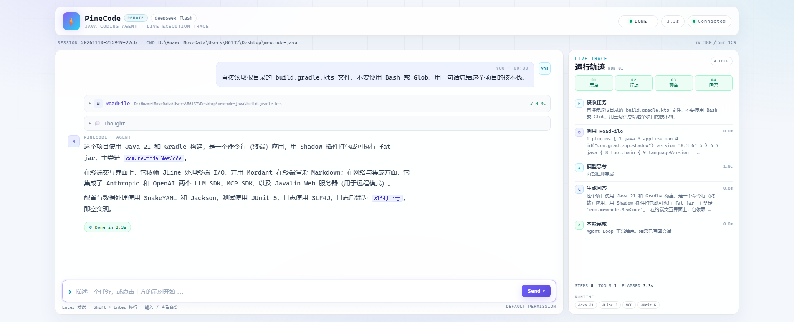
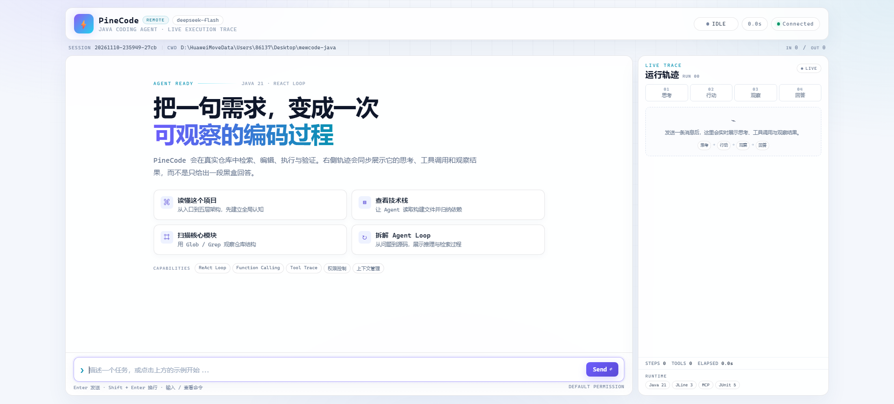
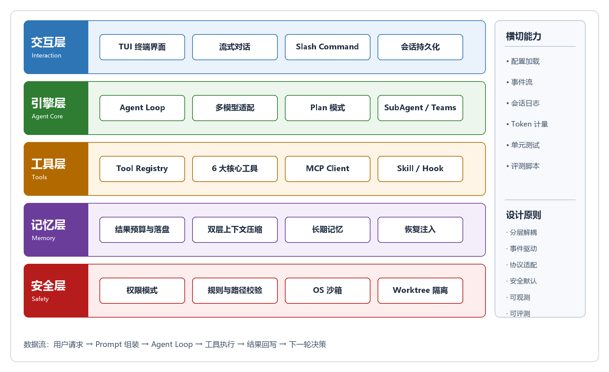
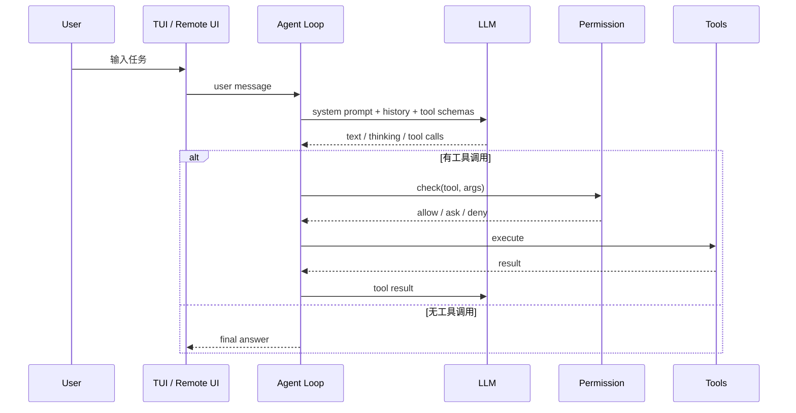

# PineCode

**A Java 21 terminal coding agent with a live execution trace.**

PineCode 是一个面向真实代码仓库的终端编程智能体。它不仅能对话，还能读取文件、修改代码、执行命令、运行测试，并把“思考 → 行动 → 观察 → 回答”的过程实时展示出来。

> **Pine = 松树，扎根仓库、持续生长；Code = 代码。**
> PineCode 希望在一次会话里持续理解仓库、做小步修改，并用测试验证结果，而不是一次性生成一大段代码。

<p>
  
  
  
  
</p>

> **项目状态**：这是一个面向毕业设计、学习与研究的技术原型，不是生产级产品。接口、配置和包名仍可能变化。

---

## 界面预览

### 实机运行：对话 + 工具调用 + 运行轨迹



一次真实运行中，PineCode 先调用 `ReadFile` 读取 `build.gradle.kts`，再根据文件内容总结技术栈。右侧 `LIVE TRACE` 同步显示步骤、工具调用、耗时和 Token 使用情况。

### 初始界面



---

## 为什么是 PineCode？

- **过程可见**：右侧运行轨迹展示思考、工具调用、观察结果和耗时，而不是只给一段黑盒回答。
- **真的会动手**：内置 `ReadFile`、`WriteFile`、`EditFile`、`Bash`、`Glob`、`Grep` 六个核心工具，能直接操作仓库。
- **改完会验证**：可以运行构建和测试，把“代码改对了吗”交给命令结果验证。
- **可扩展**：支持 MCP 外部工具、Skill 技能包、Hook 生命周期和 Slash Command。
- **Java 原生**：Java 21 + 虚拟线程 + JLine 3 + Mordant，适合 Java 技术栈的学习和二次开发。
- **双前端**：默认 TUI 终端界面，也提供 Remote Web UI；两者共用同一套 Agent 核心。

---

## 功能一览

| 能力 | 状态 | 说明 |
|---|---|---|
| ReAct Agent Loop | ✅ | 模型决策、工具执行、结果回写、循环终止 |
| 六大核心工具 | ✅ | ReadFile / WriteFile / EditFile / Bash / Glob / Grep |
| 多模型接入 | ✅ | Anthropic、OpenAI、OpenAI-compatible |
| MCP 工具协议 | ✅ | 连接外部 MCP Server，把远端工具注册为本地工具 |
| Skill 技能包 | ✅ | 把 prompt + 工具 + 资源打包为可按需加载的能力 |
| Hook 生命周期 | ✅ | 工具调用前后、会话开始结束等节点执行自定义逻辑 |
| Slash Command | ✅ | 内置和用户自定义命令 |
| 双层上下文压缩 | ✅ | 工具结果预算/落盘 + 摘要 + 最近原文 + 恢复附件 |
| 跨会话记忆 | ✅ | 用户级 + 项目级 Markdown 记忆与索引 |
| 权限与路径保护 | ✅ | 权限模式、危险命令检测、受保护路径、OS 沙箱 |
| 子 Agent | ✅ | 独立上下文执行子任务，结果回传父 Agent |
| Git Worktree 隔离 | ✅ | 并行修改使用独立工作树 |
| Agent Teams | 🧪 | 多 Agent 团队协作原型，仍在完善 |
| TUI 终端界面 | ✅ | JLine 3 + Mordant |
| Remote Web UI | ✅ | Javalin + WebSocket + 原生 HTML/CSS/JS |
| 单元测试 | ✅ | JUnit 5 |

---

## 系统架构



PineCode 采用五层架构：

| 层 | 职责 | 关键模块 |
|---|---|---|
| 交互层 | 用户怎么和 Agent 打交道 | TUI、Remote Web UI、Slash Command、会话持久化 |
| 引擎层 | Agent 怎么思考、决策、编排 | Agent Loop、LLM Adapter、Plan 模式、SubAgent、Teams |
| 工具层 | Agent 怎么真正动手 | ToolRegistry、六大工具、MCP Client、Skill、Hook |
| 记忆层 | Agent 怎么记住又不烧 Token | 结果预算、双层压缩、长期记忆、恢复注入 |
| 安全层 | Agent 有能力但不失控 | 权限模式、规则校验、路径保护、OS 沙箱、Worktree |

横切能力包括配置加载、事件流、会话日志、Token 计量、单元测试和评测脚本。

### 一次任务的数据流

```text
用户输入
  → PromptBuilder 组装系统提示、记忆和工具 Schema
  → Agent Loop 调用 LLM（流式）
  → 模型返回文本 / 思考 / tool calls
  → 权限检查 + Hook
  → 工具执行
  → 结果预算裁剪 / 落盘
  → 结果写回对话
  → 下一轮决策
  → 无 tool call 时结束
  → 事件流驱动 TUI / Web UI 更新
```

### Agent Loop 时序



核心实现位置：

- [`Agent.java`](src/main/java/com/mewcode/agent/Agent.java)：Agent Loop、流式事件、工具执行、压缩触发
- [`ToolRegistry.java`](src/main/java/com/mewcode/tool/ToolRegistry.java)：工具注册、延迟加载、Schema 导出
- [`ContextCompactor.java`](src/main/java/com/mewcode/compact/ContextCompactor.java)：双层上下文压缩
- [`PermissionChecker.java`](src/main/java/com/mewcode/permission/PermissionChecker.java)：权限判定
- [`RemoteServer.java`](src/main/java/com/mewcode/remote/RemoteServer.java)：Remote UI 的 HTTP/WebSocket 桥接
- [`index.html`](src/main/resources/com/mewcode/remote/index.html)：Remote UI 前端

---

## 三种运行模式

PineCode 不是“只能待在终端里”的工具。默认是 TUI，也可以把同一个 Agent 核心暴露为 Web UI。

| 模式 | 启动方式 | 适用场景 |
|---|---|---|
| **TUI** | `java -jar build/libs/pinecode.jar` | 日常终端使用，最接近 Claude Code 的体验 |
| **Remote** | `java -jar build/libs/pinecode.jar --remote=:18888` | 浏览器演示、答辩、远程查看运行轨迹 |
| **Print** | `java -jar build/libs/pinecode.jar -p "..."` | 脚本化、非交互式执行 |

> **重要安全提示**
> - Remote 模式默认监听 `0.0.0.0`，且没有内置登录认证。请只在本机/可信局域网使用；公网部署必须加反向代理、认证和防火墙。
> - Print 模式使用 `BYPASS` 权限模式，会自动批准工具调用。请只在一次性、可丢弃的工作区使用。
> - `--remote` 和 `-p` 都不适合直接暴露给不可信用户。

---

## 快速开始

### 1. 环境要求

- JDK 21
- 网络（首次构建需要下载 Gradle 依赖）
- 可选：Node.js / `npx`（如果配置 MCP Server）
- 可选：Linux/macOS 下的 `bubblewrap` 或 Seatbelt（OS 级沙箱）

### 2. 克隆仓库

```bash
git clone https://github.com/peng-chengb0/pinecode.git
cd pinecode
```

### 3. 创建配置

```bash
mkdir -p .mewcode
cp config.example.yaml .mewcode/config.yaml
```

Windows PowerShell：

```powershell
New-Item -ItemType Directory -Force .mewcode
Copy-Item config.example.yaml .mewcode\config.yaml
```

然后编辑 `.mewcode/config.yaml`，填入你的模型服务商信息。

> `.mewcode/` 已被 `.gitignore` 忽略。**不要把真实 API Key 提交到仓库。**

### 4. 构建

```bash
./gradlew shadowJar
```

Windows：

```powershell
.\gradlew.bat shadowJar
```

构建产物：

```text
build/libs/pinecode.jar
```

### 5. 启动

**TUI 终端模式：**

```bash
java -jar build/libs/pinecode.jar
```

**Remote Web UI：**

```bash
java -jar build/libs/pinecode.jar --remote=:18888
```

浏览器打开：

```text
http://localhost:18888
```

**Print 非交互模式：**

```bash
java -jar build/libs/pinecode.jar -p "用三句话总结这个仓库"
```

### 6. 运行测试

```bash
./gradlew test
```

---

## 配置说明

完整示例见 [`config.example.yaml`](config.example.yaml)。

```yaml
providers:
  - name: my-provider
    protocol: openai-compat
    base_url: https://api.example.com/v1
    api_key: "YOUR_API_KEY"
    model: your-model
    thinking: false
    max_output_tokens: 8192

permission_mode: default

mcp_servers: []
```

### Provider 协议

| `protocol` | 使用的 API | 适用服务 |
|---|---|---|
| `anthropic` | Anthropic Messages API | Anthropic Claude |
| `openai` | OpenAI Responses API | 支持 Responses API 的 OpenAI 服务 |
| `openai-compat` | OpenAI Chat Completions API | DeepSeek、Ollama、vLLM、LM Studio 等 |

`openai` 和 `openai-compat` 不是一回事：

- `openai` 走 `/responses`；
- `openai-compat` 走 `/chat/completions`，兼容面更广。

API Key 也可以不写在 YAML 里，而是通过环境变量提供：

- `ANTHROPIC_API_KEY`
- `OPENAI_API_KEY`（`openai` / `openai-compat` 都会回退到这个变量）

### 自定义配置文件路径

```bash
java -jar build/libs/pinecode.jar --remote=:18888 ./my-config.yaml
```

或者：

```bash
MEWCODE_CONFIG=./my-config.yaml java -jar build/libs/pinecode.jar
```

### MCP Server

```yaml
mcp_servers:
  - name: context7
    command: npx
    args: ["-y", "@upstash/context7-mcp"]
```

MCP Server 是外部进程，启动失败不会阻止主程序运行，但对应工具不可用。

---

## 使用示例

在 TUI 或 Remote UI 中直接输入自然语言任务：

```text
读取根目录的 build.gradle.kts，用三句话总结技术栈。
```

```text
找出当前仓库里失败的那个测试，定位原因，只修改相关源文件，然后重新运行测试。
```

```text
解释 Agent Loop 的终止条件，并定位对应源码。
```

```text
列出 src/main/java 下的核心模块，并按功能分类。
```

输入 `/` 可以查看 Slash Command 菜单。

Remote UI 右侧会同步展示：

- 思考过程
- 工具名和参数
- 工具执行结果
- 权限请求
- 耗时与 Token 使用量

---

## 项目结构

```text
pinecode/
├── build.gradle.kts
├── settings.gradle.kts
├── config.example.yaml
├── gradle/wrapper/
├── assets/
│   ├── architecture.png
│   ├── screenshot-home.png
│   └── screenshot-live.png
└── src/
    ├── main/java/com/mewcode/
    │   ├── agent/          # Agent Loop、事件流、流式工具执行
    │   ├── llm/            # Anthropic / OpenAI / OpenAI-compatible 客户端
    │   ├── tool/           # Tool 接口、注册表、六大工具
    │   ├── compact/        # 上下文压缩与恢复
    │   ├── memory/         # 用户级/项目级长期记忆
    │   ├── permission/     # 权限模式、规则、路径保护
    │   ├── mcp/            # MCP 客户端管理
    │   ├── subagent/       # 子 Agent 任务
    │   ├── worktree/       # Git Worktree 隔离
    │   ├── teams/          # Agent Teams 协作
    │   ├── remote/         # Remote UI 的 HTTP/WebSocket 服务
    │   ├── tui/            # JLine + Mordant 终端界面
    │   ├── skill/          # Skill 技能包
    │   ├── hook/           # Hook 生命周期
    │   └── session/        # 会话持久化
    └── main/resources/com/mewcode/remote/
        └── index.html      # Remote UI 前端
```

> **命名说明**：本仓库和产品名是 **PineCode**；Java 包名仍保留 `com.mewcode`，配置目录仍为 `.mewcode`，这是为了兼容当前原型实现。命名空间迁移（`com.mewcode` → `com.pinecode`）已列入 Roadmap。

---

## 关键设计

### 1. Agent Loop

每一轮：

1. 组装 system prompt、历史消息和工具 Schema；
2. 调用 LLM 流式接口；
3. 收集文本、思考块和 tool calls；
4. 如果有工具调用，执行工具并把结果写回对话；
5. 如果没有工具调用，结束循环。

工具调用的终止条件不是硬编码“任务完成”关键词，而是**模型是否还请求工具**。这让循环更通用。

### 2. 双层上下文压缩

- **Layer 1**：对单条工具结果做预算控制，超长结果落盘并以引用替换；
- **Layer 2**：接近上下文窗口时，对较早对话生成结构化摘要，保留最近若干轮原文，并重新注入最近读取的文件片段、Skill 等恢复信息；
- 压缩决策以服务端返回的真实 Token 用量为锚点，减少纯字符估算的偏差；
- 连续压缩失败时熔断，避免死循环。

### 3. 权限与安全

- `DEFAULT`：读操作放行，写/命令询问；
- `ACCEPT_EDITS`：写操作放行，命令仍询问；
- `PLAN`：只探索和生成计划，不改源码；
- `BYPASS`：全部放行，仅用于隔离的演示/一次性环境；
- 危险命令正则：`rm -rf /`、`mkfs`、`dd` 写盘、`curl | sh` 等；
- 受保护路径：`.mewcode/config.yaml`、权限文件、Skills 目录等；
- Linux/macOS 可选 bubblewrap / Seatbelt 沙箱；
- Git Worktree 隔离并行修改。

---

## 评测计划

当前仓库包含核心模块的 JUnit 测试，并已通过多轮手工端到端任务验证。系统化评测仍在进行中，计划包括：

- **任务集**：20–30 个代码任务，覆盖修 bug、加功能、重构、补测试、写文档；
- **指标**：任务成功率、测试通过率、平均轮次、Token、耗时、工具错误率；
- **对比**：单轮对话基线 vs 完整 Agent；
- **消融**：关闭压缩、关闭记忆、关闭权限；
- **安全测试**：危险命令、路径越界、受保护文件写入、MCP 返回值注入。

README 不会预先填写未实测的指标；实验结果会在后续版本和论文中补充。

---

## Roadmap

- [ ] 一键演示剧本与环境重置
- [ ] Diff / 测试结果可视化面板
- [ ] 事件流录制与回放（答辩离线兜底）
- [ ] 答辩演示模式（字号切换、隐藏侧栏、快捷键）
- [ ] 会话历史侧栏、恢复、导出
- [ ] 指标面板（成功率、Token、耗时、工具成功率）
- [ ] `com.mewcode` → `com.pinecode` 命名空间迁移
- [ ] CI（构建 + 测试）
- [ ] 更完整的权限/沙箱测试
- [ ] 第三方依赖与许可证审计

---

## 已知限制

- 依赖外部模型 API，网络、额度和模型行为会影响体验；
- Remote UI 没有内置认证，只适合本机或可信网络；
- Windows 下 `Bash` 工具通常依赖 WSL/Git Bash，路径和行为可能与 Linux 不同；
- MCP Server 是外部进程，可能因网络或 `npx` 环境失败；
- SubAgent / Worktree / Agent Teams 仍是原型，尚未做大规模评测；
- 当前包名 `com.mewcode` 与产品名 PineCode 暂时不一致；
- 尚未完成大规模 SWE-bench 类评测。

---

## 参考与致谢

PineCode 的 Agent Loop 设计参考了 Claude Code 的 agentic loop 思想；五层架构和部分模块设计参考了 MewCode 项目的公开资料。原始源码头部注释保留，以标明参考来源。

项目使用或参考了以下开源项目/服务：

- [Claude Code](https://code.claude.com/docs/en/how-claude-code-works) — agentic loop 与工具编排思路
- [MewCode](https://www.xiaolincoding.com/project/mewcode.html) — 五层架构与 Java 版参考实现
- [Model Context Protocol](https://modelcontextprotocol.io/) — MCP 协议与 SDK
- [JLine 3](https://github.com/jline/jline3) — 终端 I/O
- [Mordant](https://github.com/ajalt/mordant) — 终端 Markdown 渲染
- [Javalin](https://javalin.io/) — Remote UI 的 HTTP/WebSocket 服务
- [Jackson](https://github.com/FasterXML/jackson) / [SnakeYAML](https://bitbucket.org/snakeyaml/snakeyaml) — JSON / YAML
- [Anthropic Java SDK](https://github.com/anthropics/anthropic-sdk-java) / [OpenAI Java SDK](https://github.com/openai/openai-java)
- [JUnit 5](https://junit.org/junit5/)

本项目是独立的学习/研究原型，与 Anthropic、MewCode 课程及其他同名产品没有隶属关系。

---

## License

当前仓库**尚未授予开源许可证**，仅用于学习、研究、毕业设计展示和代码审阅。第三方依赖和参考实现仍遵循其各自许可证。

在确认代码权利和第三方许可证之前，请不要直接将本项目用于商业分发。如需复用，请先联系仓库作者。
